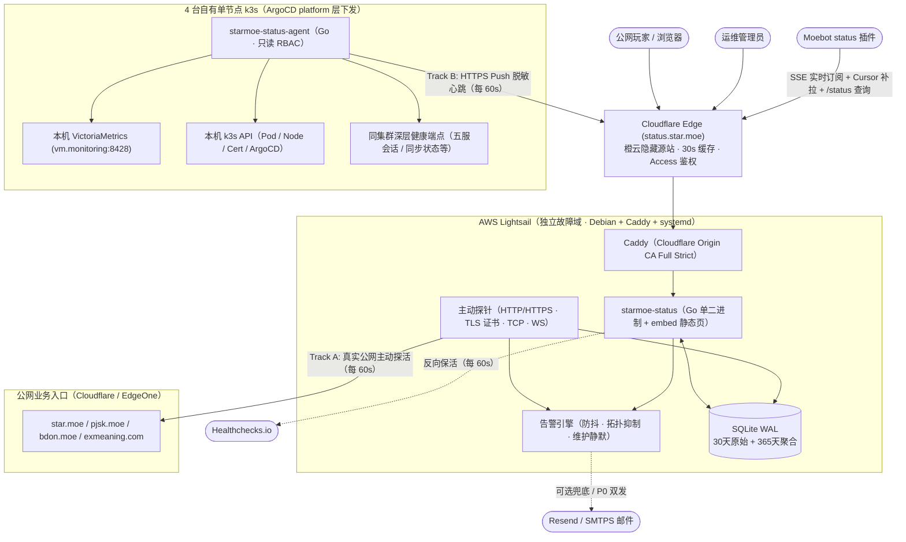

# StarMoe Status (`status.star.moe`) 架构与实施设计文档

状态：定稿 v1.0 · 日期：2026-11-24 · 覆盖阶段：M1（MVP 上线）、M2（全集群 Agent 与运维台）、M3（Moebot 插件与生态集成）

---

## 1. 目标与边界

StarMoe Status（`status.star.moe`）是 StarMoe 的**独立状态页、全栈健康监测中心与主动告警平台**，部署于独立 AWS Lightsail 节点，与 DE / JP1 / JP2 / US 四台业务服务器彻底隔离。

### 负责范围
- **公开状态页（`/`、`/incidents`）**：按产品线（StarMoe 平台、MoeSekai、MoeNotes）向玩家透明展示实时可用性、90 天可用率色块、近 24h 响应延迟、双线路（国内 EdgeOne / 海外 Cloudflare）状态、Sekai 五服子状态摘要、以及故障公告（Incident）与计划维护（Maintenance）时间线。
- **内部运维台（`/admin`，Cloudflare Access 保护）**：聚合 4 台 k3s 节点的 CPU/内存/磁盘水位、异常 Pod、ArgoCD 同步状态、cert-manager 证书临期、Sekai 五服登录会话明细、Masterdata 同步新鲜度，以及公告发布与告警静默管理。
- **主动告警引擎**：补齐当前缺失的 P0 告警能力，支持防抖、拓扑依赖抑制、维护静默，通过 **`moebot` 插件**推送至 QQ 群，并支持**可选邮件（P0 兜底 / 故障降级）**。
- **生态对外契约**：提供公开脱敏摘要 API（供 `pjsk.moe` / `bdon.moe` 页脚嵌入状态徽标）与 RSS/Atom 订阅源。

### 不负责范围
- **不替代节点内 VictoriaMetrics**：不拉取或长期存储全量 Prometheus 指标明细，仅按 60 秒间隔汇总关键资源水位与健康结论。
- **不执行集群变更或自愈动作**：`status-agent` 严格只读，绝不持有集群写权限（如重启 Pod、切换 VPN 节点等操作不归 Status 执行）。
- **不暴露任何敏感基础设施细节**：公开接口与页面严禁返回服务器公网 IP、主机名、内部 Pod 名称、内部上游域名（如 `seka-api.exmeaning.com`）或精确磁盘路径。

---

## 2. 已定决策总表

| 事项 | 决定 |
|---|---|
| 域名 | `status.star.moe`（经 Cloudflare 橙云代理，隐藏 Lightsail 源站 IP） |
| 独立托管节点 | **AWS Lightsail**（Debian + Caddy + systemd，**不安装 k3s**，保持极简单机堡垒） |
| 服务端技术栈 | **Go**（`net/http` + SQLite WAL 单文件存储 + `embed.FS` 内嵌静态前端），与 `starmoe-connect` 同构 |
| 前端技术栈 | **Next.js（静态导出 `output: 'export'`）+ React 19 + Tailwind CSS 4**，构建产物打包进 Go 单二进制 |
| 集群采集 Agent | 极简 Go 程序 `starmoe-status-agent`，同仓库构建并共享协议类型；推送至 GHCR，由 ArgoCD 经 `infra/platform/status-agent/` 统一下发至 DE / JP1 / JP2 / US |
| 管理员认证 | **Cloudflare Access** 保护 `/admin` 与 `/api/admin/*`（彻底脱离 DE `login.star.moe` 与 US `passport.star.moe` 故障域） |
| 边缘抗大流量 | Cloudflare Cache Rule 缓存 `/api/v1/summary` 30 秒，防止主站大故障时玩家高频刷新压垮 Lightsail |
| QQ 群告警 | **走 `moebot` 插件**：`starmoe-status` 提供鉴权 SSE 实时事件流 + cursor 补拉 + 状态查询 API，`moebot` 插件主动连接（无需为 `moebot` 暴露公网入站端口）；同时保留可选 HMAC Webhook |
| 邮件告警 | **可选配置**（支持 Resend HTTPS API 或 SMTPS 465/587），支持 `off` / `fallback`（QQ 失败或 P0 超时兜底）/ `p0_always` 三种策略 |
| 自身保活与备份 | 反向心跳至外部监控（如 Healthchecks.io 免费版，Lightsail 宕机超 3 分钟触发邮件）；SQLite 每日热备份推送至对象存储（R2 / S3） |
| 展示裁剪 | `sll.star.moe`（`swp-server`）与 `bili.pjsk.moe`（`moe-bili-sync`）仅纳入**内部监控与告警**，不公开展示 |

---

## 3. 总体架构与仓库结构

### 3.1 Pull + Push 双轨架构



### 3.2 仓库目录结构（`StarMoe-org/starmoe-status`）

```text
starmoe-status/
├── pkg/
│   └── protocol/              # 服务端与 Agent 共享的 Go 结构体（心跳、指标、告警事件）
├── server/                    # Lightsail 中心服务端（Go）
│   ├── cmd/starmoe-status/    # 入口（内嵌 web/out）
│   └── internal/
│       ├── config/            # 环境变量 + monitors.yaml 热加载
│       ├── store/             # SQLite WAL 访问、迁移、聚合、定期清理与备份
│       ├── prober/            # HTTP/HTTPS/TLS/TCP/WS 并发探活引擎
│       ├── ingest/            # 4 集群心跳接收、Dead-Man's-Switch 巡检
│       ├── alert/             # 状态机、拓扑依赖抑制、维护静默、Bot SSE 广播、邮件分发
│       ├── auth/              # Cloudflare Access JWT 校验、Cluster/Bot Token 校验
│       └── httpapi/           # /api/v1/*、/api/ingest/*、/api/bot/*、/api/admin/*、/rss.xml
├── agent/                     # 4 节点只读采集器（starmoe-status-agent）
│   ├── cmd/status-agent/
│   ├── internal/
│   │   ├── vm/                # 查询本机 VictoriaMetrics
│   │   ├── k8s/               # 只读 Pod / Node / Certificate / ArgoCD
│   │   ├── deep/              # 同集群结构化业务健康端点采集
│   │   └── reporter/          # 定期 HTTPS Push 上报（指数退避）
│   └── Dockerfile             # 多阶段构建 distroless 镜像 -> GHCR
├── web/                       # Next.js 16 静态导出（Tailwind CSS 4）
│   └── src/app/
│       ├── page.tsx           # 公开状态页（分组状态、90天色块、双线/五服展开、公告横幅）
│       ├── incidents/         # 历史故障与维护时间线
│       └── admin/             # 内部运维大盘（4 节点水位、异常 Pod、五服明细、公告管理）
├── config/
│   └── monitors.example.yaml  # 声明式监控清单模板（生产配置不提交敏感凭据）
├── deploy/
│   ├── lightsail/             # Caddyfile、systemd unit、备份 cron、安装脚本
│   └── k8s/                   # ArgoCD platform/status-agent 参考清单（RBAC + Deployment）
└── docs/
    └── design.md              # 本文档
```

> **安全红线**：若本仓库设为公开仓库，遵循 `starmoe-connect` 规范：严禁提交任何密钥、Token、服务器公网 IP 或内部敏感 URL，CI 开启 `gitleaks` 扫描。

---

## 4. 完整监控清单与可见性边界（基于 2026-11-24 实扫）

### 4.1 公开状态页清单（`visibility: public`）

| 公开分组 | 组件 ID | 展示名称 | 探测方式（已实测） | 归属节点 | 级别 |
|---|---|---|---|---|---|
| **StarMoe 平台** | `starmoe-passport` | 统一账号中心 (Passport) | `GET https://passport.star.moe/api/status` → `204` | US | P0 |
| | `starmoe-connect` | 第三方账号连接 (Connect) | `GET https://connect.star.moe/healthz` → `200` | US | P0 |
| **MoeSekai (PJSK)** | `pjsk-web` | MoeSekai 主站 (`pjsk.moe`) | `GET https://pjsk.moe/` → `200`（副探 `snowyviewer.exmeaning.com`） | DE | P0 |
| | `pjsk-api` | 用户与同步 API (`passport.pjsk.moe`) | `GET https://passport.pjsk.moe/healthz` → `200` | US | P0 |
| | `pjsk-ranking-cn` | 实时排行榜（国内加速线） | `GET https://rks-n.exmeaning.com/api/public/v2/jp/latest` → `200` | US | P0 |
| | `pjsk-ranking-global` | 实时排行榜（海外线路） | `GET https://rks-n.pjsk.moe/api/public/v2/jp/latest` → `200` | US | P0 |
| | `pjsk-servers` | 游戏数据服务（JP / CN / TW / KR / EN 五服折叠子项） | **聚合自 US Agent 采集的 `moe-sekai-api-derm /health`**（不暴露上游域名） | US | P0 |
| | `pjsk-prediction` | 活动预测与数据采集 (`rk.exmeaning.com`) | `GET https://rk.exmeaning.com/public/events?region=jp` → `200`（超时 `8s`） | US | P1 |
| | `pjsk-baijing` | 百景排行榜 (`baijing.exmeaning.com`) | `GET https://baijing.exmeaning.com/health` → `200` 且 `redis==true` | US | P1 |
| | `pjsk-storage-cn` | 游戏资源分发（国内加速线） | `GET https://storage.exmeaning.com/trees/jp/storage` → `200` | DE (`dev`) | P0 |
| | `pjsk-storage-global` | 游戏资源分发（海外线路） | `GET https://storage.pjsk.moe/trees/jp/storage` → `200` | DE (`dev`) | P0 |
| | `pjsk-assets-extra` | 扩展静态资源 & Hub | `HEAD https://moe.exmeaning.com/data/music_meta/music_metas.json` + `assets.pjsk.moe` 校验 | US / DE | P1 |
| | `pjsk-metadata` | 游戏元数据与自动同步 | `GET https://metadata.pjsk.moe/health`（及 `metadata.exmeaning.com`）+ 聚合 JP2/US `masterdata-sync` 同步健康 | DE / JP2 / US | P1 |
| | `pjsk-story-search` | 剧情全文搜索 (`story-search.pjsk.moe`) | `GET https://story-search.pjsk.moe/healthz` → `ok && ready` | DE | P1 |
| | `pjsk-translation` | 剧情翻译服务 (`translation.exmeaning.com`) | `GET https://translation.exmeaning.com/readyz` → `200` | DE | P1 |
| **MoeNotes (bdon)** | `bdon-web` | MoeNotes 主站 (`bdon.moe`) | `GET https://bdon.moe/` → `200` | JP1 | P0 |
| | `bdon-api` | 账号与核心 API | `GET https://passport.bdon.moe/healthz` + `https://bdon-api.bdon.moe/health` → `200` | US | P0 |
| | `bdon-ranking` | 排行榜 API (`api.bdon.moe`) | 待补 1 个公开只读 GET 路径（或加 `/healthz`），上线前先由 US Agent 监控 Pod 兜底 | US | P1 |
| | `bdon-room` | 车牌 / 房间 (`room.bdon.moe`) | 待补 1 个公开只读 GET/WS 路径（或加 `/healthz`），上线前先由 JP1 Agent 监控 Pod 兜底 | JP1 | P1 |
| | `bdon-assets` | 资源与元数据 | `GET https://assets.bdon.moe/health` + `https://metadata.bdon.moe/healthz` + `storage.bdon.moe` 探活 | JP1 / DE | P1 |
| **基础设施摘要（脱敏）** | `infra-de` / `infra-jp1` / `infra-jp2` / `infra-us` | 德国 / 日本一 / 日本二 / 美国节点 | 仅映射为 `正常 / 负载偏高 / 异常`，**隐藏 IP、主机名与容量数值** | 对应节点 | P0 |

### 4.2 仅内部监控与告警清单（`visibility: internal`，仅 `/admin` 与 QQ/邮件告警）

| 类别 | 监控项 | 探测方式 | 归属节点 | 级别 |
|---|---|---|---|---|
| **内部业务站点** | `sll.star.moe` (`swp-server`) | `GET https://sll.star.moe/api/health` → `200` | DE | P1 |
| | `bili.pjsk.moe` (`moe-bili-sync`) | `GET https://bili.pjsk.moe/` → `200` | JP2 | P1 |
| **上游与代理明细** | `moe-sekai-api-derm` 五服会话明细 | US Agent 读 `/health`：`active_sessions`、`last_login_error` | US | P0 / P1 |
| | `vpngate-proxy` (`cn`/`kr`/`tw`/`rotator`) | US Agent 检 `vpngate-proxy` 命名空间 4 Pod 状态 | US | P1 |
| **内部构建与同步** | `moesekai-masterdata-sync` (`jp`/`en`) | JP2 Agent 读 `/healthz`：`consecutiveFailures`、`lastSuccess` | JP2 | P1 |
| | `moesekai-masterdata-sync-cn` (`cn`) | US Agent 读 `/healthz`：`consecutiveFailures`、`lastSuccess` | US | P1 |
| | `pjsk-meta-builder` | JP2 Agent 读 `/healthz`：`status`、`selfTest.failed` | JP2 | P1 |
| | `dev/sekai-serve` & `dev/sekai-watch` | DE Agent 检 `dev` 命名空间 Pod 存活 | DE | P0 / P1 |
| | `pot-provider` (`:4416/ping`) & `rsshub` (`:1200` TCP) | JP2 Agent 内部探测 | JP2 | P2 |
| **平台控制面** | `ci.star.moe`、`login.star.moe`、`zeabur-*.star.moe`、`passport-admin.star.moe` | 外部 HTTPS 状态码探测（允许 `302`/`401` 视作服务存活） | DE / 各节点 / US | P1 |
| | ArgoCD 28 个 `Application` | DE Agent 只读查询 `argocd` 命名空间 `applications.argoproj.io` | DE | P1 |
| **底层中间件与宿主机** | SeaweedFS `:9333/cluster/healthz` + `/mnt/extra-storage` 挂载校验 | DE Agent 内部检查（防 `nofail` 重启掉挂载写爆根盘） | DE | P0 |
| | PostgreSQL (JP2/US) & Redis (JP2/US) | Agent 检 Pod 存活 + 本地 TCP 连通 | JP2 / US | P0 |
| | 4 节点 CPU / 内存 / 磁盘水位 + 异常 Pod + 证书临期 | Agent 读 `vm.monitoring:8428` 与 k8s API | 全 4 节点 | P0 / P1 / P2 |

### 4.3 显式排除名单（避免历史遗留产生误报）
- JP2 `default/py313-test`（历史崩溃测试 Pod）
- JP2 `apps/moe-ranking-hub-next`、`apps/moe-sekai-api`、`apps/mysekai-housing-ranking-api`（已缩容 `0/0` 的迁移前遗留对象）
- DE `apps/rip-trigger`（`0/0`）、`apps/ci-relay`（待下线过渡组件）
- 全部命名空间内 `phase == Succeeded`（`Completed`）的一次性 Job Pod（如 `apps/sw-vacuum-*`）

---

## 5. `starmoe-status-agent`（Go）采集与上报规范

### 5.1 最小权限 RBAC（严格只读）
```yaml
apiVersion: rbac.authorization.k8s.io/v1
kind: ClusterRole
metadata:
  name: starmoe-status-agent
rules:
  - apiGroups: [""]
    resources: ["nodes", "pods"]
    verbs: ["get", "list"]
  - apiGroups: ["apps"]
    resources: ["deployments"]
    verbs: ["get", "list"]
  - apiGroups: ["cert-manager.io"]
    resources: ["certificates"]
    verbs: ["get", "list"]
  - apiGroups: ["argoproj.io"] # 仅 DE 节点启用
    resources: ["applications"]
    verbs: ["get", "list"]
```

### 5.2 深层健康规则与默认阈值
| 采集对象 | 判定为 `degraded`（P1 告警） | 判定为 `down`（P0 告警） |
|---|---|---|
| **宿主机磁盘（根盘 / 数据盘）** | 使用率 `>= 85%`（DE 根盘当前 80%） | 使用率 `>= 92%` 或 Node `DiskPressure=True` |
| **宿主机内存** | 可用内存 `< 10%` 且 Swap 使用 `> 60%` | Node `MemoryPressure=True` |
| **DE 数据盘挂载校验** | — | `/mnt/extra-storage` 挂载设备不是 `/dev/vdb1`（防止掉挂载） |
| **业务 Pod 健康** | 15 分钟内重启 `>= 3` 次或 `Ready < Desired`（排除 `0/0`） | 核心 P0 服务 `Ready == 0` 持续 3 分钟 |
| **cert-manager 证书** | 任意 `Certificate` `Ready != True` 或距过期 `< 14 天` | 距过期 `< 3 天` |
| **US Sekai API 五服（`/health`）** | 某服 `active_sessions == 1` 或 `last_login_error != null` | 某服 `active_sessions == 0`（持续 3 分钟） |
| **Masterdata 同步（`/healthz`）** | `consecutiveFailures >= 3` 或 `now - lastSuccess > 15m` | `consecutiveFailures >= 10` 或 `now - lastSuccess > 60m` |
| **pjsk-meta-builder（`/healthz`）** | `selfTest.failed` 非空或 `status != "ok"` | 端点不可达持续 3 分钟 |
| **sekai-story-search（`/healthz`）** | 任意区服 `loaded == false` | `ok != true` 或 `ready != true` |
| **集群心跳超时（Dead-Man's-Switch）** | 心跳失联 `> 2m`（观察期） | 心跳失联 `> 3m`（触发整机失联 P0 + 拓扑抑制） |

### 5.3 心跳上报协议
- **端点**：`POST https://status.star.moe/api/ingest/heartbeat`
- **认证**：`Authorization: Bearer <per-cluster-token>`（DE / JP1 / JP2 / US 各自独立 Token，存于各集群 SOPS 加密 Secret，服务端仅存 SHA-256 哈希）。
- **Payload 摘要**：包含 `cluster`、`timestamp`、`host_metrics`（CPU/Mem/Disks/Mounts）、`node_conditions`、`unhealthy_pods`、`expiring_certs`、`argocd_unhealthy`、`deep_checks`（各内部结构化健康结果），**不包含任何 IP 或敏感环境变量**。

---

## 6. 数据模型（SQLite WAL）

单文件 SQLite 位于 `/var/lib/starmoe-status/status.db`，开启 `PRAGMA journal_mode=WAL; PRAGMA synchronous=NORMAL; PRAGMA busy_timeout=5000;`。

```sql
-- 1. 监控项定义（启动或热重载时从 monitors.yaml 同步）
CREATE TABLE monitors (
  id TEXT PRIMARY KEY,
  name TEXT NOT NULL,
  group_key TEXT NOT NULL,           -- platform | moesekai | moenotes | infra | internal
  kind TEXT NOT NULL,                -- http | tls | tcp | agent_node | agent_deep
  cluster TEXT,                      -- DE | JP1 | JP2 | US | NULL
  visibility TEXT NOT NULL,          -- public | internal
  severity TEXT NOT NULL,            -- P0 | P1 | P2
  current_state TEXT NOT NULL DEFAULT 'unknown', -- up | degraded | down | maintenance | unknown
  consecutive_fails INTEGER NOT NULL DEFAULT 0,
  consecutive_oks INTEGER NOT NULL DEFAULT 0,
  last_latency_ms INTEGER,
  last_message TEXT,
  meta_json TEXT,                    -- 扩展展示态（如五服子状态 JSON、证书剩余天数）
  last_checked_at INTEGER,
  sort_order INTEGER NOT NULL DEFAULT 0
);

-- 2. 分钟级原始探测样本（保留 30 天，定时清理）
CREATE TABLE check_samples (
  id INTEGER PRIMARY KEY AUTOINCREMENT,
  monitor_id TEXT NOT NULL,
  state TEXT NOT NULL,               -- up | degraded | down
  status_code INTEGER,
  latency_ms INTEGER,
  tls_days_left INTEGER,
  message TEXT,
  checked_at INTEGER NOT NULL
);
CREATE INDEX idx_samples_mon_time ON check_samples(monitor_id, checked_at DESC);

-- 3. 小时 / 天聚合统计（保留 365 天，支撑 90 天色块条与趋势图）
CREATE TABLE uptime_buckets (
  monitor_id TEXT NOT NULL,
  bucket_type TEXT NOT NULL,         -- hour | day
  bucket_ts INTEGER NOT NULL,
  ok_count INTEGER NOT NULL DEFAULT 0,
  degraded_count INTEGER NOT NULL DEFAULT 0,
  down_count INTEGER NOT NULL DEFAULT 0,
  latency_sum_ms INTEGER NOT NULL DEFAULT 0,
  latency_max_ms INTEGER NOT NULL DEFAULT 0,
  PRIMARY KEY (monitor_id, bucket_type, bucket_ts)
);

-- 4. 4 集群心跳快照（实时展示 + 保留 7 天水位历史供 /admin 画曲线）
CREATE TABLE node_heartbeats (
  id INTEGER PRIMARY KEY AUTOINCREMENT,
  cluster TEXT NOT NULL,             -- DE | JP1 | JP2 | US
  cpu_load1 REAL,
  mem_used_pct REAL,
  swap_used_pct REAL,
  root_disk_pct REAL,
  extra_disk_pct REAL,
  unhealthy_pod_count INTEGER NOT NULL DEFAULT 0,
  payload_json TEXT NOT NULL,        -- 完整脱敏细节（异常 Pod、证书、ArgoCD、深层探针）
  received_at INTEGER NOT NULL
);
CREATE INDEX idx_hb_cluster_time ON node_heartbeats(cluster, received_at DESC);

-- 5. 状态跃迁事件表（供审计、复盘、以及 Bot 订阅消费）
CREATE TABLE state_events (
  id INTEGER PRIMARY KEY AUTOINCREMENT,
  monitor_id TEXT NOT NULL,
  cluster TEXT,
  severity TEXT NOT NULL,
  prev_state TEXT NOT NULL,
  next_state TEXT NOT NULL,
  suppressed_by TEXT,                -- 若被节点失联或维护窗口抑制，记录原因 ID
  summary TEXT NOT NULL,
  detail_json TEXT,
  created_at INTEGER NOT NULL
);

-- 6. 故障公告与计划维护
CREATE TABLE incidents (
  id TEXT PRIMARY KEY,
  type TEXT NOT NULL,                -- incident | maintenance
  title TEXT NOT NULL,
  status TEXT NOT NULL,              -- investigating | identified | monitoring | resolved | scheduled | in_progress
  impact TEXT NOT NULL,              -- minor | major | critical | maintenance
  affected_monitors TEXT NOT NULL,   -- JSON array of monitor IDs
  starts_at INTEGER,                 -- 维护窗开始（自动静默受影响组件告警）
  ends_at INTEGER,                   -- 维护窗结束
  created_by TEXT,                   -- CF Access 邮箱
  created_at INTEGER NOT NULL,
  updated_at INTEGER NOT NULL
);

CREATE TABLE incident_updates (
  id INTEGER PRIMARY KEY AUTOINCREMENT,
  incident_id TEXT NOT NULL,
  status TEXT NOT NULL,
  message TEXT NOT NULL,
  created_by TEXT,
  created_at INTEGER NOT NULL
);

-- 7. 告警投递与重试记录（邮件 / 可选 Webhook；Bot 插件则通过 state_events.id 游标消费）
CREATE TABLE alert_deliveries (
  id INTEGER PRIMARY KEY AUTOINCREMENT,
  event_id INTEGER NOT NULL,
  channel TEXT NOT NULL,             -- email | webhook
  status TEXT NOT NULL,              -- pending | sent | failed
  attempts INTEGER NOT NULL DEFAULT 0,
  last_error TEXT,
  next_retry_at INTEGER NOT NULL,
  created_at INTEGER NOT NULL
);
```

---

## 7. 告警引擎与 `moebot` 插件对接协议

### 7.1 与 `moebot-sekai` 插件框架的无缝集成
已查阅 [moebot-sekai/internal/plugin/plugin.go](file:///Users/tonyall/AIProjects/moebot/moebot-sekai/internal/plugin/plugin.go)，插件实现 `plugin.Plugin` 与 `plugin.Configurable` 后即可在 Moebot 控制台表单中热配置。

**推荐采用「主动拉流（SSE + 游标补拉）」模式，无需给 `moebot` 开公网入站端口：**
1. **实时订阅**：`moebot` 的 `starmoe-status` 插件启动后台 goroutine，携带 `Authorization: Bearer <bot-token>` 连接：
   - `GET https://status.star.moe/api/bot/stream?after_id=<last_seen_event_id>`（Server-Sent Events 长连接，30s 心跳保活）。
   - 收到 `alert` 事件后，插件按本地配置的**级别与群路由规则**（如 P0 发核心运维群并 `@管理员`，P1/P2 发巡检群）格式化发往 QQ 群，并把最新 `event_id` 持久化到插件数据目录。
   - **断线不丢消息**：若 `moebot` 重启或网络波动，重连时自动带上 `after_id`，`starmoe-status` 通过 `GET /api/bot/events?after_id=...` 补发断线期间遗漏的未抑制告警（超过 30 分钟的旧告警自动合并为一条摘要防刷屏）。
2. **QQ 群主动查询指令**（插件顺手提供，运维体验极佳）：
   - `/status` → 调用 `GET /api/bot/summary`，回复全站概览与当前异常项；
   - `/status 节点` → 回复 DE / JP1 / JP2 / US 四节点 CPU/内存/磁盘水位与异常 Pod；
   - `/status 五服` → 回复 Sekai `jp`/`cn`/`tw`/`kr`/`en` 有效会话数与 Masterdata 同步版本。
3. **控制台可配项（`Manifest.Settings`）**：
   - `status_url`（默认 `https://status.star.moe`）
   - `bot_token`（鉴权令牌）
   - `p0_groups` / `p1_groups`（逗号分隔群号）
   - `min_severity`（`P0` / `P1` / `P2`）
   - `notify_recovered`（是否发送恢复通知，默认 `true`）

### 7.2 可选邮件通道（与 QQ 群形成容灾互补）
- 支持通过配置二选一：**Resend HTTPS API**（推荐，免费 3,000 封/月）或 **SMTPS（465/587）**。
- `EMAIL_POLICY` 支持三种模式：
  - `off`：关闭邮件；
  - `fallback`（推荐）：当 `moebot` SSE 客户端离线超过 2 分钟（服务端可实时感知 Bot 是否在线！）、或 P0 故障持续 5 分钟未解决时，自动发邮件兜底；
  - `p0_always`：所有 P0 告警同步双发 `moebot` 与邮件。

> **亮点**：因为 `moebot` 插件与 Lightsail 维持 SSE 长连接，**`starmoe-status` 服务端还能天然感知 `moebot` 自身是否在线**！一旦 `moebot` 断线超过 3 分钟，立即自动切邮件兜底，绝不会出现“Bot 挂了 + 业务挂了 = 无人知晓”的死角。

---

## 8. HTTP API 与安全设计

| 路由 | 鉴权 | 缓存与安全要点 |
|---|---|---|
| `GET /api/v1/summary` | 公开 | `Cache-Control: public, max-age=15, s-maxage=30`；仅返回 `visibility=public` 项、脱敏节点态、活跃公告；可供各主站页脚调用（CORS 放行 `*.star.moe`、`*.pjsk.moe`、`*.bdon.moe`、`*.exmeaning.com`） |
| `GET /api/v1/monitors/{id}/history` | 公开 | 仅允许查询 `visibility=public` 的 ID，返回 90 天日可用率 + 近 24h 延迟 |
| `GET /api/v1/incidents` & `/rss.xml` | 公开 | 公开故障与计划维护列表、RSS Feed |
| `POST /api/ingest/heartbeat` | `Bearer <cluster-token>` | 每集群独立 Token，校验 `token` 与 body 中 `cluster` 字段匹配，防越权伪造 |
| `GET /api/bot/stream`, `/api/bot/events`, `/api/bot/summary` | `Bearer <bot-token>` | 专供 `moebot` 插件消费与查询 |
| `GET /api/admin/overview` | **Cloudflare Access JWT** | 校验 `Cf-Access-Jwt-Assertion` 签名与 `aud`/`iss`；返回全部 internal 监控、4 节点水位、异常 Pod、五服会话、Bot 在线态 |
| `POST/PATCH /api/admin/incidents` | **Cloudflare Access JWT** | 发布/更新故障公告、创建计划维护窗、手动触发静默或测试邮件/Bot 告警 |
| `GET /healthz` | 公开 | Lightsail 自身健康检查（校验 SQLite 可写 + 最近一轮探测时间戳） |

---

## 9. AWS Lightsail 部署与运维基线

1. **网络与防火墙（Lightsail Networking）**：
   - 关闭 80 端口或仅作 HTTPS 跳转；**443 端口仅允许 Cloudflare 回源 IP 段**（定期脚本同步或 Lightsail 安全规则）；
   - SSH 端口仅放行管理员密钥登录（复用 `macbook_id_ed25519`），禁用密码登录。
2. **反向代理（Caddy）**：
   - 使用 Cloudflare Origin CA 签发的 15 年源站证书，Cloudflare SSL/TLS 设为 **Full (Strict)**；
   - Caddy 反向代理至 `127.0.0.1:8080`，对 `/api/bot/stream` 自动关闭缓冲以支持 SSE 实时推送。
3. **进程与发版**：
   - 单个 `systemd` 服务 `starmoe-status.service` 运行于非 root 用户 `starmoe`，配置文件位于 `/etc/starmoe-status/`，数据位于 `/var/lib/starmoe-status/`。
   - GitHub Actions 在推送 `main` 时交叉编译 `linux/amd64`（或 `arm64`）单二进制并发布 Release / SSH 滚动替换 + `systemctl restart`，同时为 `agent` 构建并推送多架构镜像到 `ghcr.io/starmoe-org/starmoe-status-agent`。
4. **反向保活与每日备份**：
   - `starmoe-status` 内部 goroutine 每 60s ping 一次外部 Dead-Man's-Switch URL（如 Healthchecks.io 免费版）。
   - 每日 04:00 UTC 执行 `sqlite3 /var/lib/starmoe-status/status.db ".backup '/tmp/status.db'"` 压缩后通过 `rclone` 传至 Cloudflare R2（保留 30 天）。

---

## 10. 分阶段实施里程碑

### M1：核心服务端 + 公开状态页 + Lightsail 上线（最快见效）
- 初始化 `starmoe-status` 仓库骨架（`pkg/protocol`、`server/`、`web/`、`config/`、`deploy/lightsail/`）。
- 完成 SQLite WAL 存储、公网主动探针引擎（HTTP/HTTPS/TLS 证书天数）、防抖状态机、`monitors.yaml` 加载。
- 完成公开状态页 `/`（StarMoe 视觉风格、三大业务组、双线路展示、90 天可用率条、24h 延迟图）、`/api/v1/summary`、`/rss.xml`。
- 完成 `/api/bot/stream` & `/api/bot/events` & `/api/bot/summary` 接口 + 可选 Resend/SMTP 邮件分发。
- 在你建好的 Lightsail 服务器完成 Caddy + systemd + Cloudflare DNS/缓存/Access 上线。

### M2：4 节点 `starmoe-status-agent` + `/admin` 运维台 + 公告系统
- 完成 Go `starmoe-status-agent`（VictoriaMetrics + k8s 只读 + DE/JP1/JP2/US 特化深层健康采集），产出 `infra/platform/status-agent/` ArgoCD 清单并铺到 4 台服务器。
- 上线集群心跳死信检测 + 拓扑依赖抑制。
- 上线 Cloudflare Access 保护的 `/admin` 内部运维台（4 节点实时水位、异常 Pod、五服会话明细、ArgoCD 状态、Incident/Maintenance 发布与自动静默）。

### M3：`moebot` 插件落地与前端生态集成
- 在 `moebot-sekai` 中新增 `internal/plugins/starmoe_status` 插件（SSE 实时推 QQ 群 + `/status` 查询指令 + 控制台配置表单）。
- 在 `pjsk.moe`、`bdon.moe`、`connect.star.moe` 页脚接入轻量的实时状态小圆点组件。
- 补齐 `api.bdon.moe` / `room.bdon.moe` 的专用 `/healthz`（或业务探活路径）。
